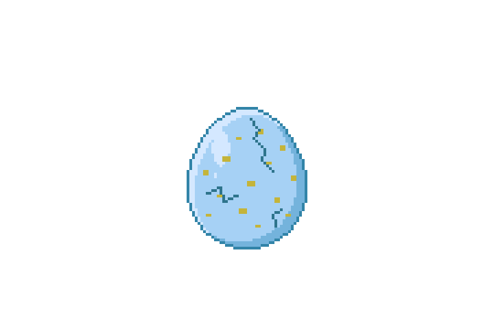

<!-- git-critters:start -->

  
   
  Made with <a href="https://github.com/aryamantepal/git-critters">git-critters</a>

<!-- git-critters:end -->

<h1 align="center">Hi, I'm Ishan Revankar 👋</h1>

  CS student @ <b>University of Maryland, College Park</b>  
   
  Full-Stack Developer | LLM Inference Researcher
   
  Focused on Multi-GPU Optimization, AI Infrastructure, and Systems Engineering

---

### 🔭 Currently Working On
- 🚀 **Disaggregated KV Caching** to extend LLM context in constrained environments
- 🧠 Researching efficient inference for large models across distributed memory tiers

---

### ⚡ Tech Stack
- 💻 **Languages:** Python · TypeScript · C++ · Java
- 🌐 **Full Stack:** React · Node.js · Next.js · Express · MongoDB · PostgreSQL
- 🧪 **ML/Infra:** PyTorch · Docker · AWS · CUDA (learning)

---

### 📫 Reach Me
- 💼 [LinkedIn](https://www.linkedin.com/in/ishanrev/)

